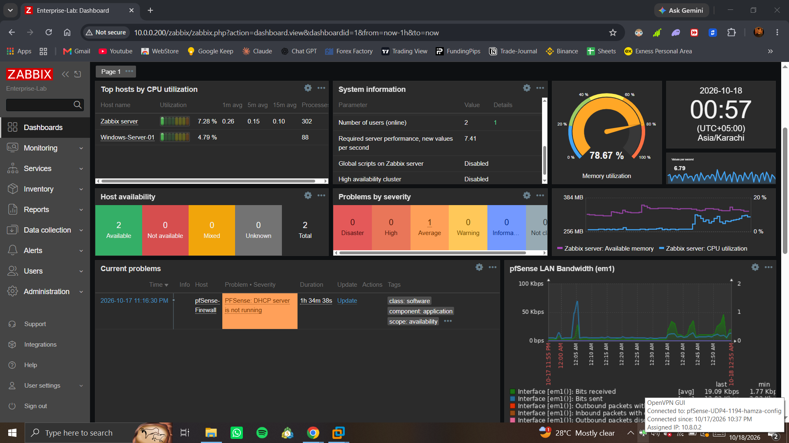
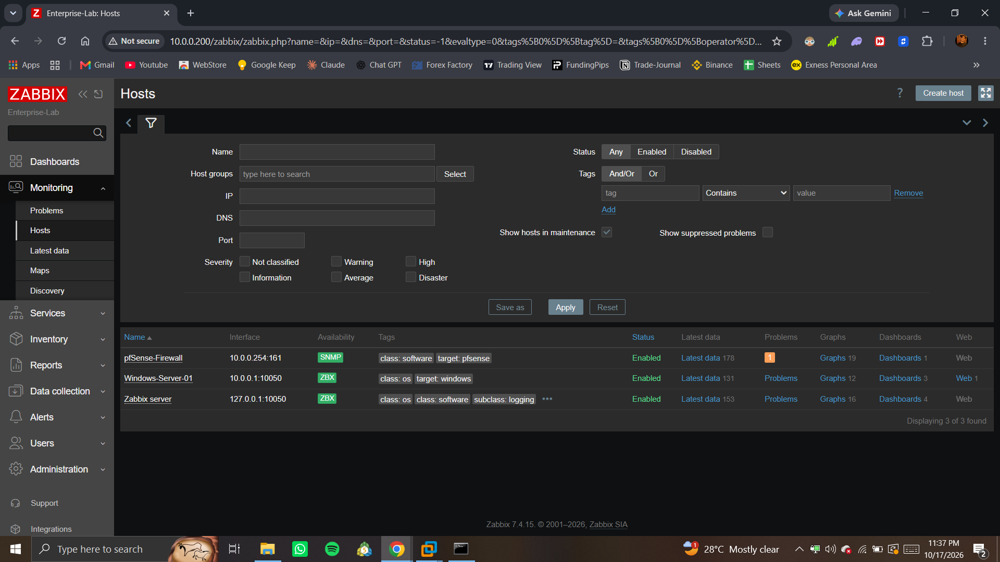
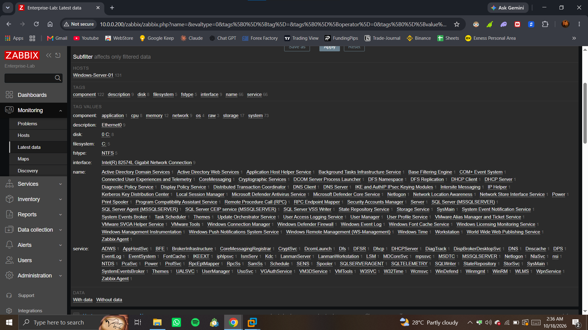
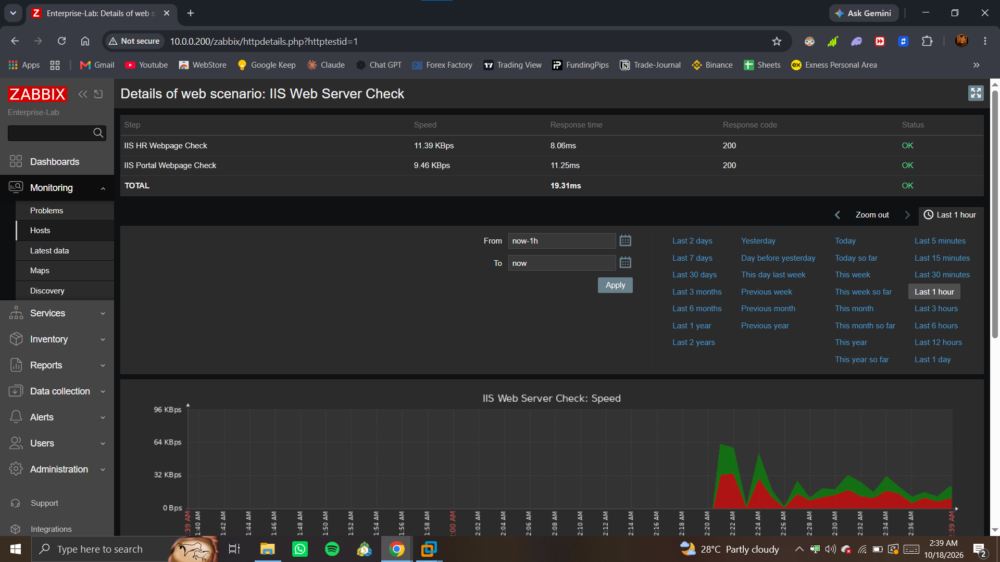
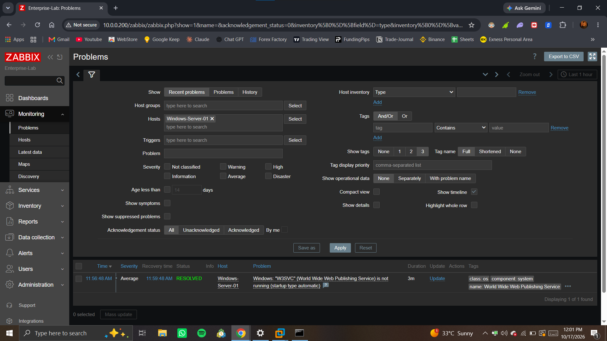

# 📊 Enterprise Server & Network Monitoring Lab (Zabbix)

## 📌 About This Project
In this lab, I installed and configured **Zabbix Monitoring Server** on **Ubuntu Linux** (`10.0.0.200`) to monitor my virtual corporate network. I connected my **Windows Server** and **pfSense Firewall** to track system resources (CPU, RAM, Disk), core Windows services, network bandwidth, and internal websites from a single dashboard while connected via **OpenVPN**.

---

## 🖧 Monitored Lab Setup

| Device / Server | IP & Port | Method | What is Monitored |
| :--- | :--- | :--- | :--- |
| **Zabbix Server (Ubuntu)** | `10.0.0.200` (`127.0.0.1:10050`) | Zabbix Agent (`ZBX`) | Ubuntu OS health, CPU, RAM, MySQL DB, and Apache web server (153 Items) |
| **Windows-Server-01** | `10.0.0.1:10050` | Zabbix Agent (`ZBX`) | Active Directory, DNS, DHCP, IIS, MS SQL Server, and `C:` Drive storage (131 Items) |
| **pfSense-Firewall** | `10.0.0.254:161` | SNMP (`SNMPv2`) | WAN/LAN network traffic (`em1`), bandwidth usage, and firewall states (178 Items) |

---

## 🛠️ What I Configured in This Lab

* **Zabbix Server Setup on Linux:** Installed Ubuntu Server LTS, configured a static IP (`10.0.0.200`) using Netplan, and set up Zabbix Server with MySQL and Apache.
* **Windows Server Monitoring (`ZBX` Agent):** Installed the Zabbix Agent on `Windows-Server-01` (`10.0.0.1`) to monitor CPU, memory, disk usage, and critical services like Active Directory (`AD DS`), `DNS`, `DHCP`, `IIS`, and `SQL Server (MSSQLSERVER)`.
* **pfSense Firewall Monitoring (`SNMP`):** Enabled the SNMP service on pfSense (`10.0.0.254`) to monitor live LAN/WAN internet traffic and network interfaces without installing an agent.
* **IIS Website Uptime Monitoring:** Created web monitoring steps for two internal websites (`http://hr.myhome.local` and `http://portal.myhome.local`) hosted on IIS using Host Headers. Fixed DNS resolution on Ubuntu via `/etc/hosts` and verified `200 OK` status codes and response times.
* **Service Down & Alert Testing:** Tested real-time alerting by stopping the Windows IIS service (`W3SVC`). Verified that Zabbix immediately showed the problem on the dashboard, tracked the 3-minute downtime, and changed the status back to `RESOLVED` once I restarted the service.

---

## 📸 Lab Screenshots

### 1. Main Zabbix Dashboard & Live LAN Traffic
Main dashboard showing server health, memory usage, live pfSense LAN bandwidth graph (`em1`), and remote connection via OpenVPN (`10.8.0.2`).

---

### 2. Connected Hosts (Zabbix Agent & SNMP)
All three hosts connected and showing active green status (`ZBX` for Windows/Linux servers and `SNMP` for the pfSense Firewall).

---

### 3. Windows Server Services & Metrics Discovery
Zabbix monitoring 131 items on `Windows-Server-01`, including Active Directory, DNS, DHCP, IIS (`W3SVC`), SQL Server (`MSSQLSERVER`), and NTFS disk space.

---

### 4. IIS Websites Uptime & Response Time Check
Live HTTP monitoring for both internal websites (`hr.myhome.local` and `portal.myhome.local`), showing `200 OK` status and fast response times (`8.06ms` and `11.25ms`).

---

### 5. Service Crash Test & Alert Resolution (`RESOLVED`)
Testing alert triggers by stopping the IIS service (`W3SVC`) on Windows Server. Zabbix detected the outage, recorded a `3m` duration, and marked it `RESOLVED` when the service started again.

---

## 👨‍💻 Author
**Mohammad Hamza Bashir**  
*IT Support & System Administration*  
📍 Karachi, Pakistan  
📧 hamzabashirkhan678@gmail.com
